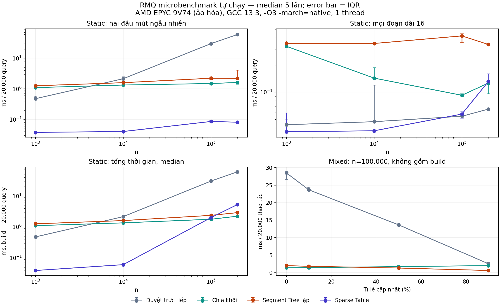

# RMQ: nghiên cứu, benchmark và khung seminar 30–40 phút

Ngày kiểm tra nguồn: 31/10/2026. Chủ đề: **Range Minimum Query**, truy vấn phần tử nhỏ nhất trên một đoạn mảng.

**Bản mở rộng theo yêu cầu:** mục 13–18 bổ sung paper thực nghiệm, so sánh CTDL, ví dụ cho từng tình huống, mở rộng thuật toán và benchmark tự chạy. Khung 40 phút ở mục 18 phù hợp hơn nếu muốn trình bày các phần này có phân tích; khung 30 phút ở mục 4 là phương án rút gọn.

## 1. Hướng trình bày đề xuất

Tên seminar: **Range Minimum Query: từ duyệt tuyến tính đến truy vấn O(1)**.

Giả định người nghe biết mảng, cây nhị phân, quy hoạch động và ký hiệu Big-O. Lấy bài toán **tĩnh** và Sparse Table làm trọng tâm; đối chiếu Segment Tree khi xuất hiện cập nhật; giới thiệu Cartesian tree và Fischer–Heun như bước tối ưu về lý thuyết. Chứng minh chi tiết của Fischer–Heun ở phần phụ lục để dùng khi thảo luận.

RMQ là tên bài toán, không phải tên riêng của Sparse Table. Cần phân biệt ba chi phí: tiền xử lý, mỗi truy vấn, và bộ nhớ phụ. Với q truy vấn, luôn viết thêm tổng thời gian.

## 2. Video: xem theo thứ tự này

Các video dưới đây bằng tiếng Anh. Chuỗi COMP526 Spring 2022 có trang transcript do chính giảng viên cung cấp; transcript nhận dạng tự động nên kiểm tra công thức bằng slide hoặc paper.

| Mã | Video | Thời lượng | Mục tiêu khi xem |
|---|---|---:|---|
| V1 | [Sebastian Wild — RMQ introduction](https://youtu.be/mLK0LZ7FfVk) | 11:50 | Định nghĩa, quy ước vị trí và mô hình bài toán |
| V2 | [Primitive RMQ solutions and Sparse Tables](https://youtu.be/b6l2UTacaUM) | 16:09 | Hai cách cực đoan, quy hoạch động và truy vấn bằng hai đoạn |
| V3 | [Cartesian trees](https://youtu.be/QNz_6DozmSE) | 28:24 | Hình dạng cây quyết định đáp án RMQ; liên hệ LCA |
| V4 | [Exhaustive Tabulation](https://youtu.be/pQJVkkDXzyk) | 21:56 | Chia khối, chia sẻ bảng tra, tiền xử lý tuyến tính |
| V5 | [LCE using RMQ](https://youtu.be/R2AiZXsp5r0) | 12:43 | Đưa RMQ vào bài toán chuỗi qua suffix array và LCP |
| V6 | [MIT 6.851 — Lecture 15: Static Trees, Erik Demaine](https://classes.csail.mit.edu/6.851/spring12/lectures/L15.html) | Khoảng 83 phút | Đọc sâu RMQ, LCA, ±1 RMQ và lookup tables |

Trang học phần xác nhận tiêu đề, thời lượng và liên kết của V1–V5: [COMP526 Unit 9, Spring 2022](https://www2.wild-inter.net/teaching/comp526/spring2022/09-range-min).

Mốc xem lại hữu ích, theo chapter của bản Spring 2022:

- V2: **7:26 — Improvements**, **9:54 — Trick**.
- V3: **0:23 — RMQ & LCA**, **13:50 — ví dụ Cartesian tree**, **15:35 — đếm cây nhị phân**.
- V4: **2:00 — Exhaustive Tabulation Trick**, **3:52 — Bootstrapping**, **13:48 — Exhaustive Tabulation**.

Chú ý V3 dùng **range maximum** cho một số hình minh họa. Đổi chiều so sánh để trở về range minimum; giữ quy ước xử lý các phần tử bằng nhau nhất quán.

Transcript trực tiếp: [V2](https://www2.wild-inter.net/videos/comp526-spring2022/9-3/), [V3](https://www2.wild-inter.net/videos/comp526-spring2022/9-4/), [V4](https://www2.wild-inter.net/videos/comp526-spring2022/9-5/).

## 3. Paper và tài liệu học thuật

### P1. Bender & Farach-Colton (2000): nên đọc đầu tiên

Michael A. Bender and Martín Farach-Colton. **The LCA Problem Revisited**. LATIN 2000, LNCS 1776, pp. 88–94. DOI: [10.1007/10719839_9](https://doi.org/10.1007/10719839_9).

- [PDF từ trang tác giả](https://www3.cs.stonybrook.edu/~bender/newpub/BenderFa00-lca.pdf).
- Đọc **§2** để hiểu LCA → RMQ và tính chất ±1 của dãy độ sâu; **§3** cho Sparse Table; **§4** cho chia khối và bảng tra; **§5** cho RMQ → LCA qua Cartesian tree.
- Dùng để chuẩn bị chứng minh và trả lời câu hỏi vì sao truy vấn O(1) với tiền xử lý O(n) là khả thi.
- Không giới thiệu đây là công trình đầu tiên giải LCA tối ưu: paper tự mô tả là cách trình bày đơn giản hóa các ý tưởng đã có.

### P2. Fischer & Heun (2006): paper trọng tâm về RMQ tổng quát

Johannes Fischer and Volker Heun. **Theoretical and Practical Improvements on the RMQ-Problem, with Applications to LCA and LCE**. CPM 2006, LNCS 4009, pp. 36–48. DOI: [10.1007/11780441_5](https://doi.org/10.1007/11780441_5).

- [Trang nhà xuất bản](https://link.springer.com/chapter/10.1007/11780441_5).
- [Bản toàn văn tác giả, lưu tại AMiner](https://static.aminer.org/pdf/PDF/000/118/469/theoretical_and_practical_improvements_on_the_rmq_problem_with_applications.pdf). Trang Springer hiển thị nội dung thuê bao; bản PDF này truy cập được khi kiểm tra.
- Đọc **§2** cho định nghĩa và thuật toán nền, **§3** cho RMQ trực tiếp với O(n) tiền xử lý/O(1) truy vấn, **§4** cho LCA và LCE, **§5** cho thực nghiệm.
- Câu hỏi đọc: Hai khối khác giá trị có thể dùng chung bảng đáp án khi nào? Vì sao chỉ cần biết hình dạng Cartesian tree? Vì sao không lập bảng cho tất cả hoán vị?
- Kết quả thực nghiệm là của môi trường trong paper năm 2006; không suy ra thuật toán này luôn nhanh nhất trên máy hiện tại.

### P3. Fischer & Heun (2011): đọc thêm về tối ưu bộ nhớ

Johannes Fischer and Volker Heun. **Space-Efficient Preprocessing Schemes for Range Minimum Queries on Static Arrays**. SIAM Journal on Computing 40(2), pp. 465–492. DOI: [10.1137/090779759](https://doi.org/10.1137/090779759).

- [Trang công bố tại KIT](https://ae.iti.kit.edu/english/1809.php).
- [PDF tại KIT](https://ae.iti.kit.edu/english/1810.php).
- Đọc abstract và introduction trước; phần §5 và Theorem 5.8 dành cho người muốn hiểu sâu cách mã hóa succinct.
- Kết quả nổi bật: O(1) truy vấn với **2n + o(n) bit** cho cấu trúc trả về vị trí cực tiểu, không cần truy cập mảng ban đầu khi truy vấn.
- Số bit này không lưu toàn bộ các giá trị tùy ý của mảng. Muốn trả lại giá trị số cần thêm cách truy cập/lưu dữ liệu gốc. Không gộp kết quả succinct năm 2011 với cấu trúc O(n) word được giới thiệu ở phần seminar chính.

### Slide và ghi chú hỗ trợ

- [Stanford CS166 — RMQ Part I](https://web.stanford.edu/class/archive/cs/cs166/cs166.1266/lectures/00/): cách dẫn dắt từ các phương án cơ bản.
- [Stanford CS166 — RMQ Part II](https://web.stanford.edu/class/cs166/lectures/01/), [slide cô đọng](https://web.stanford.edu/class/cs166/lectures/01/Condensed%20slides.pdf): Cartesian tree và Fischer–Heun. Slide công khai; liên kết paper restricted trên trang khóa học yêu cầu đăng nhập, nên dùng P2 ở trên.
- [MIT Lecture 15 — scribe notes](https://classes.csail.mit.edu/6.851/spring12/scribe/lec15.pdf): theo dõi song song với V6. Với tên/năm công trình, ưu tiên thông tin từ paper gốc.
- [Sparse Table — tài liệu triển khai](https://cp-algorithms.com/data_structures/sparse-table.html).
- [Segment Tree — tài liệu triển khai](https://cp-algorithms.com/data_structures/segment_tree.html).

## 4. Kịch bản 30 phút, đủ năm yêu cầu

Đây là 30 phút trình bày; thời gian hỏi đáp nếu có nên cộng riêng.

| Thời gian | Slide | Nội dung và kết quả cần đạt | Yêu cầu |
|---|---|---|---|
| 0–3 phút | 1–2 | Bối cảnh dữ liệu cảm biến, phát biểu static RMQ, phân biệt min/argmin | Đặt vấn đề |
| 3–6 phút | 3–4 | Duyệt từng đoạn; tiền xử lý tất cả đoạn; đánh đổi thời gian–bộ nhớ | Cơ sở thuật toán |
| 6–15 phút | 5–7 | Sparse Table: trạng thái, truy hồi, chứng minh truy vấn, chạy ví dụ | Cơ sở và giải bài toán |
| 15–19 phút | 8 | Bảng độ phức tạp; khi có cập nhật chuyển sang Segment Tree | Phân tích và lựa chọn |
| 19–24 phút | 9–10 | Cartesian tree, chia khối, tái sử dụng bảng theo hình dạng cây; kết quả O(n)/O(1) | Tối ưu |
| 24–30 phút | 11–12 | LCA, LCE; bài tập và ba kết luận chính | Ứng dụng |

Gợi ý lời dẫn:

1. **Slide 1, 0–1 phút:** “Có n số đo đã thu xong và nhiều câu hỏi: số đo thấp nhất trong một khoảng là bao nhiêu? Nếu mỗi lần đều quét lại dữ liệu, ta đang lặp lại rất nhiều công việc.” Ví dụ cảm biến là bối cảnh minh họa tự xây dựng, không phải mô tả một hệ thống cụ thể.
2. **Slide 2, 1–3 phút:** Ghi rõ mảng tĩnh, đoạn đóng [l,r], chỉ số từ 1. Hỏi người nghe về sự khác nhau giữa giá trị nhỏ nhất và vị trí đạt giá trị đó.
3. **Slide 3, 3–4 phút:** Vẽ một đoạn truy vấn và đếm r−l+1 lần đọc. Đưa ra O(nq) tệ nhất cho q truy vấn.
4. **Slide 4, 4–6 phút:** Đưa ra bảng n(n+1)/2 đáp án; dùng truy hồi thay vì quét từng đoạn để xây trong O(n²).
5. **Slide 5, 6–9 phút:** Chỉ lưu các độ dài 1,2,4,8,...; giải thích ghép hai nửa để xây Sparse Table.
6. **Slide 6, 9–12 phút:** Che đoạn truy vấn bằng hai đoạn có độ dài là lũy thừa của 2; nhấn mạnh tính lũy đẳng của min.
7. **Slide 7, 12–15 phút:** Chạy ví dụ ở mục 5; trình bày pseudocode, không đọc toàn bộ mã C++.
8. **Slide 8, 15–19 phút:** So sánh các phương án bằng cả preprocessing/query/space. Đặt câu hỏi “Nếu sửa một số đo thì sao?” để giới thiệu Segment Tree.
9. **Slide 9, 19–21 phút:** Giới thiệu Cartesian tree: inorder theo chỉ số, min-heap theo giá trị; LCA của hai đầu đoạn cho vị trí cực tiểu.
10. **Slide 10, 21–24 phút:** Nêu ba phần của một truy vấn qua nhiều khối và ý tưởng dùng chung bảng. Chỉ trình bày kết luận độ phức tạp; chuyển chứng minh đếm loại khối xuống phụ lục.
11. **Slide 11, 24–28 phút:** Chọn LCA làm ứng dụng chính; giới thiệu LCE qua một công thức và ví dụ “banana”.
12. **Slide 12, 28–30 phút:** Giao bài static/dynamic và chốt: tiền xử lý để tái sử dụng; chồng lấn hợp lệ với min; chọn cấu trúc theo điều kiện cập nhật.

Nếu lớp đã học Sparse Table: rút phần 6–15 phút còn 6 phút và chuyển 3 phút sang chứng minh Fischer–Heun. Nếu lớp chưa học cây/LCA: giữ mục này ở mức hình minh họa, không cố trình bày đầy đủ hai phép quy dẫn và thuật toán succinct trong cùng 30 phút.

## 5. Bài toán và ví dụ xuyên suốt

Cho mảng tĩnh A[1..n], cần trả lời q truy vấn với 1 ≤ l ≤ r ≤ n:

\[
\operatorname{minval}(l,r)=\min_{l\le i\le r}A[i].
\]

Trong paper, RMQ thường trả về **chỉ số**:

\[
\operatorname{RMQ}(l,r)=\arg\min_{l\le i\le r}(A[i],i).
\]

So sánh cặp theo thứ tự từ điển để chọn vị trí bên trái khi bằng nhau. Khi có chỉ số p, lấy giá trị bằng A[p].

Ví dụ tự xây dựng:

| i | 1 | 2 | 3 | 4 | 5 | 6 | 7 | 8 |
|---|---:|---:|---:|---:|---:|---:|---:|---:|
| A[i] | 5 | 2 | 6 | 3 | 1 | 7 | 4 | 8 |

- minval(2,7) = 1; RMQ(2,7) = 5.
- minval(1,4) = 2; RMQ(1,4) = 2.
- minval(6,8) = 4; RMQ(6,8) = 7.
- Với [4,1,1], truy vấn cả mảng trả giá trị 1, vị trí 2 theo quy ước bên trái.

### Từ duyệt trực tiếp đến Sparse Table

**Duyệt trực tiếp:** Không xây cấu trúc; mỗi truy vấn quét O(r−l+1), tệ nhất O(n). Tổng q truy vấn là O(nq).

**Lưu mọi đoạn:** D[l][l] = A[l]; D[l][r] = min(D[l][r−1], A[r]). Có Θ(n²) ô hợp lệ, mỗi ô O(1); tiền xử lý và bộ nhớ Θ(n²), truy vấn O(1). Nếu tính riêng từng ô bằng cách quét lại thì có thể tốn Θ(n³), nên cần chỉ rõ cách xây.

**Sparse Table:** Đặt st[k][i] là giá trị nhỏ nhất của đoạn bắt đầu ở i, dài 2^k:

\[
st[0][i]=A[i],\qquad
st[k][i]=\min\big(st[k-1][i],st[k-1][i+2^{k-1}]\big).
\]

Chỉ xây khi i+2^k−1 ≤ n. Với L=r−l+1 và k=⌊log₂ L⌋:

\[
\operatorname{minval}(l,r)=\min\big(st[k][l],st[k][r-2^k+1]\big).
\]

Hai đoạn [l,l+2^k−1] và [r−2^k+1,r] nằm trong đoạn hỏi và phủ kín nó, vì 2^k ≤ L < 2^(k+1). Chúng có thể chồng lấn. Lấy min nhiều lần một phần tử không thay đổi kết quả: min(x,x)=x. Đây là tính **lũy đẳng**, bên cạnh tính kết hợp của min. Nguồn cơ sở: P1 §3, V2, tài liệu Sparse Table.

Với ví dụ trên:

| k / độ dài | Các giá trị st[k][i] hợp lệ, theo i tăng dần |
|---|---|
| 0 / 1 | 5, 2, 6, 3, 1, 7, 4, 8 |
| 1 / 2 | 2, 2, 3, 1, 1, 4, 4 |
| 2 / 4 | 2, 1, 1, 1, 1 |
| 3 / 8 | 1 |

Truy vấn [2,7] dài 6 nên k=2. Lấy hai đoạn [2,5] và [4,7], có cực tiểu lần lượt 1 và 1. Đáp án là 1. Không cộng hai kết quả: đây là phép min.

```text
build(A):
    lg[1] = 0
    for x = 2..n:
        lg[x] = lg[floor(x/2)] + 1
    st[0] = A
    for k = 1..lg[n]:
        for i = 1..n - 2^k + 1:
            st[k][i] = min(st[k-1][i], st[k-1][i + 2^(k-1)])

query(l, r):
    k = lg[r-l+1]
    return min(st[k][l], st[k][r - 2^k + 1])
```

Số ô hợp lệ là tổng theo k của (n−2^k+1), bằng Θ(n log n). Mỗi ô tính trong O(1), nên xây Θ(n log n). Tiền xử lý lg tốn O(n) và giúp mỗi query chỉ gồm các phép truy cập/so sánh O(1). Tổng thời gian tính cả đọc đầu vào là O(n log n + q).

Nếu cần vị trí, st lưu **chỉ số**; phép ghép so sánh (A[p],p), không lấy min hai chỉ số một cách độc lập với giá trị.

## 6. So sánh thời gian và bộ nhớ

Bảng dưới tính **bộ nhớ phụ ngoài mảng đầu vào**. Đơn vị word cho các hàng thông thường; hàng cuối ghi riêng bit. Giả định so sánh và các thao tác trên chỉ số máy tốn O(1). Chi phí đọc n giá trị đầu vào là O(n), không được tính là “tiền xử lý cấu trúc” ở hàng duyệt trực tiếp.

| Cách làm | Tiền xử lý | Một truy vấn, tệ nhất | Bộ nhớ phụ | Cập nhật điểm |
|---|---:|---:|---:|---|
| Duyệt trực tiếp | O(1) | O(n) | O(1) word | O(1) |
| Bảng mọi đoạn, xây bằng DP | O(n²) | O(1) | O(n²) word | Không phù hợp |
| Chia khối √n | O(n) | O(√n) | O(√n) word | O(√n), quét lại khối |
| Segment Tree | O(n) | O(log n) | O(n) word | O(log n) |
| Sparse Table | O(n log n) | O(1) | O(n log n) word | Không thiết kế cho cập nhật |
| Fischer–Heun, bản chia khối | O(n) | O(1) | O(n) word | Tĩnh |
| Succinct RMQ, P3 | O(n) | O(1) | 2n+o(n) **bit** cho cấu trúc argmin | Tĩnh |

Chia khối √n lưu cực tiểu của từng khối. Một truy vấn quét tối đa hai mảnh biên và duyệt các cực tiểu của các khối đầy đủ: O(√n). Segment Tree ghép min của hai con; xây bottom-up O(n), cập nhật và truy vấn O(log n). Nguồn: slide Stanford Part I, tài liệu Segment Tree; P1–P3 cho các hàng tối ưu.

Tổng thời gian cho n phần tử và q truy vấn: duyệt O(n+nq); chia khối O(n+q√n); Segment Tree O(n+q log n); Sparse Table O(n log n+q); Fischer–Heun O(n+q). Với u cập nhật, Segment Tree là O(n+(q+u)log n).

Ví dụ ước lượng bộ nhớ tự tính: n=200.000, cấp phát Sparse Table hình chữ nhật 18×n ô số nguyên 32 bit cần 14.400.000 byte ≈ 13,73 MiB, chưa gồm mảng A, lg và overhead. Con số này là tính theo layout cụ thể, không phải kết quả benchmark. Lưu argmin hoặc lưu giá trị đều có thể dùng 32 bit trong ví dụ này; nếu lưu cặp, dung lượng mỗi ô thay đổi.

## 7. Tối ưu O(n) tiền xử lý: giải thích đủ dùng

### 7.1 Cartesian tree và hai phép quy dẫn

Cartesian tree của mảng có inorder theo thứ tự chỉ số và thỏa min-heap theo cặp (A[i],i). Vị trí cực tiểu toàn mảng làm gốc; hai đoạn bên trái/phải tạo hai cây con.

- **RMQ → LCA:** Trong Cartesian tree, LCA của hai node mang chỉ số l và r chính là vị trí cực tiểu trên A[l..r].
- **LCA → RMQ:** DFS ghi lại node mỗi lần đi xuống hoặc trở về theo cạnh, tạo Euler tour E dài 2n−1 và mảng độ sâu D. Giữa lần xuất hiện đầu tiên của u và v, node có độ sâu nhỏ nhất là LCA(u,v).
- Dãy D có hai phần tử liên tiếp chênh đúng +1 hoặc −1. Đây là **±1 RMQ**, một trường hợp riêng; mảng RMQ tổng quát không tự có tính chất này.

Chuỗi lập luận của P1 là RMQ tổng quát → Cartesian tree/LCA → Euler tour/±1 RMQ → chia khối và tra bảng. Không phải suy luận vòng: trường hợp ±1 được giải độc lập.

Định nghĩa cây theo đệ quy không tự bảo đảm O(n) xây dựng. Nếu cứ quét tìm min từng lần có thể tốn O(n²). Muốn xây tuyến tính dùng monotonic stack: mỗi phần tử được đẩy và lấy khỏi stack nhiều nhất một lần.

### 7.2 Ý tưởng Fischer–Heun trực tiếp

Nguồn: P2 §3 và Stanford Part II. Dùng b = max(1,⌊(1/4)log₂ n⌋); với n nhỏ có thể xử lý trực tiếp. Chia mảng thành các khối b phần tử. Khối cuối thiếu phần tử có thể đệm khóa +∞ với chỉ số riêng, không ảnh hưởng truy vấn trên chỉ số thật.

1. Tính min và vị trí min của mỗi khối, tạo mảng tổng hợp M dài m=⌈n/b⌉.
2. Xây Sparse Table trên M. Vì m=O(n/log n), chi phí m log m = O(n).
3. Trong mỗi khối, câu trả lời argmin phụ thuộc vào **hình dạng canonical Cartesian tree**, không phụ thuộc giá trị số cụ thể.
4. Các khối cùng loại chia sẻ một bảng tra cho mọi cặp vị trí nội khối. Mã hóa loại khối trong O(b), ví dụ bằng thao tác stack; tổng thời gian phân loại là O(n).
5. Một truy vấn khác khối ghép tối đa ba ứng viên: hậu tố khối trái, các khối đầy đủ ở giữa, tiền tố khối phải. Truy vấn cùng khối chỉ cần một bảng tra. Nếu không có khối đầy đủ ở giữa, bỏ thành phần đó.

Phải dùng cùng quy tắc chọn cực tiểu bên trái khi có giá trị trùng nhau. Khi ghép các ứng viên của các khối khác nhau, vẫn so sánh giá trị trong mảng gốc cùng chỉ số.

### 7.3 Chứng minh chi phí để ở slide dự phòng

Số cây nhị phân có thứ tự với b node là số Catalan C_b < 4^b. Có thể dùng mã hình dạng dài O(b) bit để đánh địa chỉ một không gian không quá 4^b loại; chỉ khởi tạo bảng cho loại xuất hiện, hoặc tiền tính toàn bộ các loại hợp lệ.

Một bảng nội khối có O(b²) câu trả lời, xây O(b²) bằng quy hoạch động. Với b≈(1/4)log₂ n:

\[
4^b\le\sqrt n,\qquad
O(4^b b^2)=O(\sqrt n\log^2 n)=o(n).
\]

Tổng tiền xử lý là:

\[
O\left(n+\frac nb\log\frac nb+4^b b^2\right)=O(n).
\]

Bộ nhớ cũng O(n) word. Mỗi query dùng số lượng hằng số các bảng tra và so sánh nên O(1). Đây là lập luận tiệm cận; b là số nguyên và các trường hợp n nhỏ cần nhánh xử lý đơn giản.

Trực giác nên nói trên sân khấu: **“Không lưu đáp án cho từng khối riêng biệt; lưu một lần cho mỗi kiểu khối.”** Hai khối có cùng thứ tự hoàn toàn thì dùng chung được, nhưng phân loại theo toàn bộ hoán vị tạo đến b! loại. Hình dạng Cartesian tree là thông tin vừa đủ cho các đáp án argmin.

O(n) tiền xử lý và O(1) truy vấn là tối ưu về bậc trong mô hình nói trên: cần đọc dữ liệu trong trường hợp tổng quát và cần ít nhất hằng số thao tác để trả một đáp án. Điều này không khẳng định cấu trúc lý thuyết luôn thắng Sparse Table trong thời gian chạy thực tế.

## 8. Ứng dụng và ví dụ trình bày

### A. Tìm tổ tiên chung gần nhất — LCA

Ứng dụng trực tiếp trên cây tĩnh: tìm quản lý chung gần nhất trong cây tổ chức, hoặc tính khoảng cách hai node. Đây là mô hình ứng dụng; bài CSES Company Queries II bên dưới cung cấp phát biểu cụ thể.

Xét cây gốc 1, có cạnh 1–2, 1–3, 2–4, 2–5, 3–6, 3–7. Theo thứ tự DFS trái trước:

| Mảng | Nội dung |
|---|---|
| E | 1,2,4,2,5,2,1,3,6,3,7,3,1 |
| D | 0,1,2,1,2,1,0,1,2,1,2,1,0 |

first[4]=3 và first[5]=5 theo chỉ số từ 1. Min độ sâu trên D[3..5] là 1, tại vị trí 4; E[4]=2 nên LCA(4,5)=2. Không tìm min trên chính ID của các node.

Đặt x=min(first[u],first[v]), y=max(first[u],first[v]). Khi RMQ_D trả vị trí:

\[
\operatorname{LCA}(u,v)=E[\operatorname{RMQ}_D(x,y)].
\]

Sau đó dist(u,v)=depth[u]+depth[v]−2depth[LCA(u,v)] cho cây không trọng số. Với cây có trọng số dùng khoảng cách tích lũy từ gốc trong công thức khoảng cách; vẫn có thể dùng độ sâu theo số cạnh cho Euler-tour LCA. Nguồn phương pháp: P1 §2; MIT Lecture 15.

### B. So sánh tiền tố của hai hậu tố — LCE

Trong xử lý chuỗi, suffix array SA sắp xếp các hậu tố theo từ điển. Quy ước LCP[t] là độ dài tiền tố chung của SA[t−1] và SA[t], với LCP[1]=0. Nếu hai hậu tố bắt đầu ở i,j có rank p<q thì:

\[
\operatorname{LCE}(i,j)=\min_{p<t\le q} LCP[t].
\]

Tức là lấy **giá trị** của RMQ trên LCP[p+1..q]. Với i=j thì trả thẳng n−i+1, không tạo đoạn RMQ rỗng.

Ví dụ tự tính S="banana", chỉ số từ 1:

- SA = [6,4,2,1,5,3], tương ứng a, ana, anana, banana, na, nana.
- LCP = [0,1,3,0,0,2].
- rank[4]=2, rank[2]=3 nên LCE(4,2)=LCP[3]=3, tức tiền tố chung "ana".

RMQ là thành phần trong chỉ mục chuỗi, hỗ trợ so khớp, tìm lặp và các bài toán chuỗi sinh học. Không tuyên bố toàn bộ hệ thống lập chỉ mục chỉ cần O(1): O(1) ở đây là mỗi truy vấn LCE **sau khi** SA, rank, LCP và cấu trúc RMQ đã được xây. Nguồn: P2 §4, V5.

## 9. Bài tập ứng dụng

| Bài | Liên kết | Mục tiêu | Hướng triển khai |
|---|---|---|---|
| CSES Static Range Minimum Queries | https://cses.fi/problemset/task/1647 | Nhiều truy vấn min, không cập nhật | Sparse Table; tổng O(n log n+q) |
| CSES Dynamic Range Minimum Queries | https://cses.fi/problemset/task/1649 | Gán giá trị một điểm xen kẽ truy vấn | Segment Tree; O(log n) mỗi thao tác |
| CSES Company Queries II | https://cses.fi/problemset/task/1688 | Quản lý chung gần nhất | Euler tour + RMQ độ sâu; có thể so sánh với binary lifting |
| Bài tự xây dựng: LCE trên banana | Dữ liệu ở mục 8 | Chuyển bài chuỗi thành truy vấn mảng | Dựng SA/LCP thủ công, trả lời LCE(2,4), LCE(3,5), LCE(1,2) |

Đáp án bài LCE tự xây dựng lần lượt là 3, 2, 0.

Một thí nghiệm seminar nếu có thêm thời gian: cùng một bộ dữ liệu, so sánh duyệt trực tiếp/Sparse Table/Segment Tree; tách thời gian build và query, dùng cùng các truy vấn ngẫu nhiên, giữ checksum để tránh trình biên dịch loại bỏ tính toán, ghi rõ máy và kiểu dữ liệu. Không đưa số tốc độ dự đoán lên slide như thể đã đo.

## 10. Các câu hỏi phản biện nên chuẩn bị

1. **Vì sao prefix minimum không giải được đoạn tùy ý?** Không có phép nghịch đảo tương tự phép trừ của prefix sum. Hai mảng [1,5,4] và [1,2,4] có cùng prefix-min [1,1,1] nhưng min của đoạn [2,2] khác nhau.
2. **Vì sao hai đoạn chồng lấn vẫn được?** Min có tính lũy đẳng. Tổng thì đếm trùng phần giao, nên không dùng nguyên công thức đó cho range sum.
3. **Sparse Table có O(1) khi dùng log không?** Tiền tính floor-log nguyên O(n) hoặc nêu rõ phép toán bit thích hợp; tránh phụ thuộc vào log số thực và lỗi làm tròn.
4. **Có cập nhật thì sao?** Sparse Table thông thường dành cho mảng tĩnh; một cập nhật có thể làm hỏng nhiều ô. Chuyển sang Segment Tree nếu cần cập nhật thường xuyên. Không nói “không thể cập nhật Sparse Table” theo nghĩa tuyệt đối.
5. **Min hay argmin?** Bài lập trình có thể yêu cầu giá trị; LCA và cấu trúc succinct cần vị trí. Phải nhất quán kiểu trả về.
6. **Giá trị bằng nhau xử lý thế nào?** So sánh (giá trị, chỉ số); chọn bên trái xuyên suốt xây bảng, Cartesian tree và ghép đáp án.
7. **Fischer–Heun hơn Sparse Table ở đâu?** Cùng O(1) query, giảm build/space từ O(n log n) xuống O(n); đổi lại triển khai phức tạp hơn và có hằng số chi phí.
8. **O(n) space có phải O(n) bit?** Không. O(n) word thường tương ứng O(n log n) bit cho các chỉ số; 2n+o(n) bit là kết quả nén riêng, không lưu mọi giá trị đầu vào.
9. **Euler tour dài bao nhiêu?** 2n−1 khi ghi node ban đầu và sau mỗi lần đi qua một cạnh theo DFS; không chỉ ghi mỗi node một lần.
10. **Có phải phải đi qua LCA để giải RMQ?** Không. P1 dùng các phép quy dẫn để giải thích; P2 cung cấp cách trực tiếp trên mảng.

## 11. Mã demo C++17

Mã này đọc định dạng của CSES Static Range Minimum Queries và in giá trị. Nội bộ dùng chỉ số từ 0, đoạn đóng; đầu vào bài dùng chỉ số từ 1. Bảng lưu chỉ số để có thể minh họa cả argmin và quy tắc chọn bên trái. Đây là mã minh họa tự viết, không chép nguyên mã từ nguồn.

```cpp
#include <algorithm>
#include <cassert>
#include <iostream>
#include <numeric>
#include <utility>
#include <vector>

class SparseRMQ {
    std::vector<int> a, lg;
    std::vector<std::vector<int>> st;

    int better(int x, int y) const {
        if (a[x] != a[y]) return a[x] < a[y] ? x : y;
        return std::min(x, y);
    }

public:
    explicit SparseRMQ(std::vector<int> values) : a(std::move(values)) {
        const int n = static_cast<int>(a.size());
        assert(n > 0);
        lg.assign(n + 1, 0);
        for (int x = 2; x <= n; ++x) lg[x] = lg[x / 2] + 1;
        st.assign(lg[n] + 1, std::vector<int>(n));
        std::iota(st[0].begin(), st[0].end(), 0);
        for (int k = 1; k <= lg[n]; ++k) {
            const int len = 1 << k;
            for (int i = 0; i + len <= n; ++i) {
                st[k][i] = better(st[k - 1][i],
                                  st[k - 1][i + len / 2]);
            }
        }
    }

    int argmin(int l, int r) const {
        assert(0 <= l && l <= r && r < static_cast<int>(a.size()));
        const int k = lg[r - l + 1];
        return better(st[k][l], st[k][r - (1 << k) + 1]);
    }

    int minimum(int l, int r) const {
        return a[argmin(l, r)];
    }
};

int main() {
    std::ios::sync_with_stdio(false);
    std::cin.tie(nullptr);
    int n, q;
    if (!(std::cin >> n >> q)) return 0;
    std::vector<int> a(n);
    for (int &x : a) std::cin >> x;
    SparseRMQ rmq(std::move(a));
    while (q--) {
        int l, r;
        std::cin >> l >> r;
        std::cout << rmq.minimum(l - 1, r - 1) << '\n';
    }
}
```

Input cho ví dụ seminar:

```text
8 3
5 2 6 3 1 7 4 8
2 7
1 4
6 8
```

Output:

```text
1
2
4
```

## 12. Thứ tự chuẩn bị hiệu quả

1. Xem V1 → V2; tự vẽ hai đoạn truy vấn và giải thích được vì sao chồng lấn hợp lệ.
2. Đọc P1 §2–§4, sau đó §5; phân biệt RMQ tổng quát và ±1 RMQ.
3. Xem V3 → V4; đọc P2 §3. Chuẩn bị một hình chia khối và một cặp khối cùng hình dạng Cartesian tree.
4. Xem V5 và đọc P2 §4 để chọn ứng dụng LCE hoặc LCA.
5. Làm bài static, rồi đổi đề thành dynamic để thấy điều kiện chọn cấu trúc.
6. Đọc P3 ở mức abstract/introduction nếu cần mở rộng về bit-space; không đưa chi tiết rank/select/DFUDS vào phần 30 phút mặc định.

Nếu thời gian chuẩn bị hạn chế: ưu tiên V2, P1 §3, slide Stanford Part II và phần ứng dụng LCA. Dành bài đọc sâu P2/P3 cho phần hỏi đáp.

Các ví dụ số, lịch phân bổ thời gian, mã demo và gợi ý trình bày trong tài liệu này là phần tổng hợp tự xây dựng. Các kết quả thuật toán và nguồn học đã được gắn liên kết để kiểm tra lại.

## 13. Paper bổ sung cho benchmark và mở rộng

### P4. Dima & Ceterchi (2015): so sánh với Binary Indexed Tree

Mircea Dima and Rodica Ceterchi. **Efficient Range Minimum Queries using Binary Indexed Trees**. Olympiads in Informatics 9, 39–44. [PDF chính thức](https://ioinformatics.org/oi/pdf/v9_2015_39_44.pdf), DOI: 10.15388/ioi.2015.04.

Đọc §2.3–2.4 về biến thể hai BIT và §2.5/Table 1 về thực nghiệm. Paper báo cáo query O(log n), update O(log n) **amortized**. Không phải Fenwick prefix-min một cây thông thường.

Benchmark paper: n=100.000, 10 triệu cập nhật, 10 triệu truy vấn; Xeon-Haswell 3,5 GHz, RAM 8 GB, Ubuntu 14, gcc 4.8. Table 1:

| Thao tác | Segment Tree của paper | Hai BIT của paper |
|---|---:|---:|
| Xây mảng 100K | 0,0009 s | 0,0006 s |
| 10M cập nhật | 1,274 s | 0,672 s |
| 10M truy vấn | 2,397 s | 0,551 s |

Đây là số đo của tác giả; không phải kết quả chạy lại. Kết luận giới hạn ở hai implementation và môi trường đó. Bảng này không đo Sparse Table.

### P5. Ferrada & Navarro (2017): bộ nhớ nén và chi phí thực tế

Héctor Ferrada and Gonzalo Navarro. **Improved Range Minimum Queries**. Journal of Discrete Algorithms 43, 72–80. [PDF từ trang tác giả](https://users.dcc.uchile.cl/~gnavarro/ps/jda16.pdf), DOI: [10.1016/j.jda.2016.09.002](https://doi.org/10.1016/j.jda.2016.09.002).

Đọc §5 và Figures 4–7: tác giả báo cáo cấu trúc khoảng 2,1 bit/phần tử và 1–3 microsecond/query trong các thí nghiệm của họ. So sánh cả độ dài truy vấn và mảng gần tăng/giảm. Chú ý §6: implementation dùng range min-max tree không có bảo đảm O(1) hình thức, dù thiết kế succinct lý thuyết đạt O(1).

### P6. Baumstark, Gog, Heuer & Labeit (2017): phân tích kỹ thuật benchmark

**Practical Range Minimum Queries Revisited**, SEA 2017, LIPIcs 75, Article 12. [Trang chính thức và PDF](https://drops.dagstuhl.de/entities/document/10.4230/LIPIcs.SEA.2017.12).

Đọc §4, Figures 5–10: so sánh NewRMQ, SDSL, Succinct, Ferrada–Navarro; đo trên một core Xeon E5-4640, GCC 4.8.4. Có dữ liệu ngẫu nhiên, gần tăng/giảm và LCP thực. Paper báo cáo nhanh hơn tới 3 lần so với các implementation trước trong thử nghiệm của họ. Đây là nguồn tốt để giải thích vì sao cần đo cache và thay đổi workload.

Mã của chính nghiên cứu: https://github.com/kittobi1992/rmq-experiments (địa chỉ được paper công bố; không được chạy lại trong bộ benchmark kèm tài liệu này).

### P7. Alzamel et al.: biết trước một lô truy vấn nhỏ

Mai Alzamel, Panagiotis Charalampopoulos, Costas S. Iliopoulos, Solon P. Pissis. **How to Answer a Small Batch of RMQs or LCA Queries in Practice**. [Preprint 2017](https://arxiv.org/abs/1705.04589), [PDF](https://arxiv.org/pdf/1705.04589); bản proceedings LNCS 10765 (2018), 343–355, DOI: [10.1007/978-3-319-78825-8_28](https://doi.org/10.1007/978-3-319-78825-8_28).

Đọc §2–3: co các vùng không chứa đầu mút truy vấn thành phần tử cực tiểu, thu mảng O(q); kết hợp thuật toán phù hợp để đạt n+O(q) thời gian và O(min(n,q)) bộ nhớ phụ trong mô hình của paper. Không chỉ xóa các vị trí không phải đầu mút: phải giữ min của vùng bị co và ánh xạ về chỉ số gốc.

Đừng gán n+O(q) cho mọi cách tự cài đặt: nếu sắp xếp đầu mút thì cần tính chi phí sort; bản Sparse Table thông thường trên mảng co có chi phí khác.

### P8. Amir, Fischer & Lewenstein (2007): RMQ hai chiều

**Two-Dimensional Range Minimum Queries**, CPM 2007, pp. 286–294. [Trang nhà xuất bản](https://link.springer.com/chapter/10.1007/978-3-540-73437-6_29). Dùng làm nguồn nghiên cứu mở rộng sang hình chữ nhật trên ma trận; trang công bố/abstract truy cập được, toàn văn có thể cần quyền truy cập.

## 14. So sánh CTDL: kèm ví dụ, không chỉ ghi Big-O

Dùng A=[5,2,6,3,1,7,4,8], chỉ số từ 1. Mỗi hàng cập nhật dưới đây bắt đầu từ **mảng ban đầu**, không cộng dồn thay đổi giữa các hàng.

| Tình huống | Cấu trúc/cách làm | Ví dụ cụ thể | Vì sao chọn hoặc loại |
|---|---|---|---|
| Ít truy vấn hoặc đoạn rất ngắn | Duyệt trực tiếp | min A[6..8]=min(7,4,8)=4 | Không tốn build; O(độ dài đoạn), thường đủ cho đoạn ngắn |
| Tĩnh, nhiều truy vấn tùy ý | Sparse Table | [2,7] tách thành [2,5] và [4,7], kết quả 1 | O(1) query, cần O(n log n) tiền xử lý/bộ nhớ |
| Cần ít bộ nhớ phụ, chấp nhận chậm hơn | Chia khối | Chọn b=3: block [1..3],[4..6],[7..8] có min 2,1,4; query [2,7] ghép min(2,1,4)=1 | Chỉ O(n/b) cực tiểu; b phải được chọn theo workload |
| Gán một phần tử thường xuyên | Segment Tree | A[5]←9; min [2,7] từ 1 thành 2 | O(log n) update/query; tổng hợp linh hoạt |
| Cộng cả đoạn | Lazy Segment Tree | Cộng 3 vào [2,5] cho [5,5,9,6,4,7,4,8]; min [2,7]=4 | Gắn lazy tag; O(log n) mỗi range-add/query |
| Hỏi min của mọi cửa sổ độ dài 3 | Monotonic deque | Kết quả 2,2,1,1,1,4 | Tổng O(n), O(3) bộ nhớ; không phục vụ đoạn tùy ý quay ngược |
| Chỉ hỏi prefix-min và giá trị chỉ giảm | Fenwick-min đơn giản | min [1,4]=2; giảm A[3] từ 6 xuống 0 thì min [1,4]=0 | O(log n); điều kiện hạn chế phải được nêu rõ |
| RMQ động với biến thể BIT | Hai BIT theo P4 | Cùng cập nhật A[5]←9 và query [2,7] trả 2 | Hỗ trợ rộng hơn BIT-min đơn giản, cài đặt khác và phức tạp hơn |
| Muốn lấy min trên một đoạn bằng heap toàn mảng | Không phù hợp nếu chỉ có heap min | Min toàn mảng là 1 ở vị trí 5 nhưng min [6,8]=4 | Heap toàn cục không mã hóa điều kiện chỉ số của đoạn |
| Tĩnh, tối ưu bậc thời gian/bộ nhớ word | Fischer–Heun | Query liên khối ghép hậu tố trái, khối giữa, tiền tố phải | O(n) build/space, O(1) query, khó triển khai hơn |

**Chi tiết ví dụ cập nhật một điểm:** sau A[5]←9, mảng là [5,2,6,3,9,7,4,8]. Trong [2,7], phần tử nhỏ nhất là **2 ở vị trí 2**; nếu query [3,7] thì min đổi từ 1 thành **3 ở vị trí 4**.

Nguồn cho CTDL động: tài liệu [Segment Tree](https://cp-algorithms.com/data_structures/segment_tree.html), [Fenwick Tree](https://cp-algorithms.com/data_structures/fenwick.html) và P4. Nguồn cửa sổ trượt: [Minimum Queue](https://cp-algorithms.com/data_structures/stack_queue_modification.html).

### Phản ví dụ cho prefix-min

Hai mảng X=[1,5,4], Y=[1,2,4] đều có prefix-min [1,1,1], nhưng min X[2..2]=5 và min Y[2..2]=2. Do đó không có công thức lấy min đoạn tùy ý từ **chỉ hai giá trị prefix-min**, tương tự prefix-sum[r]−prefix-sum[l−1]. Điều này không phủ định các biến thể hai BIT trong P4.

### So sánh bằng tổng chi phí

Với p là build time, t là thời gian trung bình một query trên cùng phân bố:

\[
T(q)\approx p+qt.
\]

Nếu Sparse Table xây chậm hơn Segment Tree nhưng query nhanh hơn, điểm hòa vốn ước lượng là:

\[
q^*\approx\frac{p_{ST}-p_{Seg}}{t_{Seg}-t_{ST}}.
\]

Chỉ dùng khi mẫu số dương, trên cùng máy/dữ liệu, và giả định t không thay đổi lớn theo số truy vấn/cache. Đây là mô hình dự đoán từ số đo, không phải định lý về một ngưỡng q cố định cho mọi máy.

## 15. Mở rộng thuật toán có ví dụ

### 15.1 Đổi phép toán: max, gcd, sum và Disjoint Sparse Table

Sparse Table truy vấn bằng hai đoạn chồng lấn phù hợp với các phép kết hợp, lũy đẳng như min/max/gcd. Ví dụ B=[12,18,6,9], gcd trên [2,4] là 3; gcd của [2,3] và [3,4] vẫn là gcd(6,3)=3.

Phản ví dụ sum: B=[1,2,3,4,5,6]. Hai đoạn [1,4] và [3,6] có tổng 10 và 18; cộng thành 28, khác tổng thật 21 vì đếm lại 3+4.

Nếu phép toán kết hợp nhưng không lũy đẳng, **Disjoint Sparse Table** dùng các đoạn không giao nhau, vẫn có O(n log n) build/space và O(1) query. Với sum tĩnh, prefix sum đã đạt O(n) build, O(n) space và O(1) query nên thường đơn giản hơn. Với phép nhân ma trận kích thước cố định, phép toán có tính kết hợp nhưng không giao hoán; Disjoint Sparse Table giữ đúng thứ tự toán hạng. Nguồn: [Sparse Table](https://cp-algorithms.com/data_structures/sparse-table.html), [bài giải thích của tác giả tutorial Disjoint Sparse Table](https://codeforces.com/blog/entry/79108?locale=en).

### 15.2 RMQ động và cập nhật đoạn

- Point update: sửa A[5]←9; min [3,7] chuyển 1→3. Segment Tree cập nhật các tổ tiên của lá 5.
- Range add: với mảng gốc, cộng 3 vào [2,5] làm min [2,7]=4. Nếu toàn bộ một node được cộng c thì min của node cũng tăng c; lưu tag cộng và chỉ đẩy xuống khi cần.
- Range assign: gán A[2..5]←10 cho [5,10,10,10,10,7,4,8]; min [2,7]=4. Tag gán cần phân biệt “chưa có tag” với “gán bằng 0”; khi kết hợp tag gán/cộng phải đúng thứ tự.

Đây là mở rộng bài toán, không phải sửa nhỏ để Sparse Table tĩnh tự có update O(log n).

### 15.3 Cửa sổ trượt: một trường hợp đặc biệt có lời giải riêng

Với A ở trên và k=3, lần lượt các cửa sổ [1,3],[2,4],[3,5],[4,6],[5,7],[6,8] trả 2,2,1,1,1,4.

Deque lưu **chỉ số**, tăng dần theo giá trị: bỏ đầu đã hết cửa sổ, bỏ cuối có giá trị lớn hơn phần tử mới, rồi thêm chỉ số mới. Mỗi chỉ số vào/ra tối đa một lần, nên tổng O(n), bộ nhớ O(k). Nếu muốn giữ argmin bên trái khi bằng nhau, chỉ bỏ cuối khi **lớn hơn**, không dùng điều kiện ≥ một cách máy móc.

So với Sparse Table cho cùng n−k+1 cửa sổ: deque O(n), Sparse Table O(n log n) kể cả build; nhưng deque không tạo ra chỉ mục trả lời mọi đoạn bất kỳ về sau.

### 15.4 RMQ hai chiều

Xét ma trận:

| | Cột 1 | Cột 2 | Cột 3 |
|---|---:|---:|---:|
| Hàng 1 | 5 | 2 | 6 |
| Hàng 2 | 3 | 1 | 7 |
| Hàng 3 | 4 | 8 | 0 |

Hình chữ nhật hàng 1..2, cột 2..3 trả 1 tại (2,2); toàn ma trận trả 0 tại (3,3).

Mở rộng Sparse Table cơ bản: lưu min các hình chữ nhật cao 2^kx, rộng 2^ky. Một query ghép tối đa bốn hình chữ nhật ở bốn góc. Theo lập luận phủ kín và lũy đẳng tương tự 1D, query O(1), build/space O(RC(1+log R)(1+log C)). Đây là **phân tích của cách mở rộng cơ bản**, không phải khẳng định đó là kết quả tốt nhất trong nghiên cứu 2D.

So sánh: quét hình chữ nhật O(diện tích), Sparse Table 2D tĩnh O(1) query nhưng tốn bộ nhớ, Segment Tree 2D hỗ trợ cập nhật điểm và truy vấn O(log R log C) với một layout chuẩn tốn O(RC) space. Bài nghiên cứu P8 cho thấy 2D có các hướng tối ưu sâu hơn; không tự động mang nguyên kết quả succinct 2n bit của 1D sang 2D. Có thể dùng bản đồ số đo hoặc ảnh xám làm ví dụ mô hình, không cần tuyên bố một phần mềm cụ thể dùng implementation này.

### 15.5 Offline với q nhỏ hơn n nhiều

Ví dụ tự xây dựng A=[9,8,7,6,5,4,3,2,1,10,11,12], Q={[2,9],[5,11]}. Đánh dấu đầu mút 2,5,9,11; thay mỗi vùng không đánh dấu bằng min, vẫn giữ các đầu mút và chỉ số gốc. Bỏ vùng trước đầu mút đầu và sau đầu mút cuối:

- Các đơn vị giữ lại: A[2], min A[3..4], A[5], min A[6..8], A[9], A[10], A[11].
- Mảng co AQ=[8,6,5,2,1,10,11].
- Ánh xạ về chỉ số gốc f=[2,4,5,8,9,10,11].
- Query [2,9] gốc thành [1,5] trên AQ, trả vị trí AQ[5], ánh xạ lại 9; query [5,11] thành [3,7], cũng trả 9.

Trong ví dụ nhỏ, tỉ lệ giảm chưa lớn. Lợi ích tiệm cận xuất hiện khi q≪n, vì AQ có O(q) phần tử. Mô hình dữ liệu, bước đánh dấu/co, và phương án giải trên AQ phải được xét cùng nhau trước khi nêu n+O(q). Xem P7.

### 15.6 Nén bộ nhớ

Với n=1.000.000, phần hạng chính 2n bit là 250.000 byte, khoảng 244 KiB; chưa gồm o(n), metadata hoặc mảng giá trị. Mục tiêu là trả **vị trí** cực tiểu. Nếu muốn trả giá trị cảm biến nguyên 32 bit, phải có thêm cách lưu/truy cập các số đo; không thể nói toàn bộ một triệu giá trị tùy ý được lưu chính xác chỉ bằng 2 triệu bit.

Nguồn: P3; P5/P6 cho khác biệt giữa cấu trúc lý thuyết và implementation thực tế.

## 16. Ứng dụng: so sánh với lời giải khác

### 16.1 LCA trên cây tĩnh

Cùng câu hỏi LCA(4,5)=2 trong cây ở mục 8:

| Phương án | Tiền xử lý | Mỗi LCA | Bộ nhớ phụ | Khi có lợi |
|---|---:|---:|---:|---|
| Lần theo parent, cân bằng độ sâu | O(n) | O(h), h là chiều cao cây | O(n) | Rất ít query, cần code đơn giản |
| Binary lifting | O(n log n) | O(log n) | O(n log n) | Cần thêm k-th ancestor hoặc ghép thông tin khi nhảy |
| Euler tour + Segment Tree | O(n) | O(log n) | O(n) | Muốn dùng cấu trúc tuyến tính quen thuộc |
| Euler tour + Sparse Table | O(n log n) | O(1) | O(n log n) | Nhiều LCA trên cây tĩnh |
| Euler tour + ±1 RMQ tối ưu | O(n) | O(1) | O(n) word | Cần kết quả tối ưu về bậc; triển khai khó hơn |

Nguồn: P1, MIT Lecture 15, [Binary lifting](https://cp-algorithms.com/graph/lca_binary_lifting.html). Không suy ra đổi cấu trúc cây tùy ý chỉ cần cập nhật Segment Tree: thêm/xóa cạnh có thể làm đổi Euler tour và nhiều độ sâu.

### 16.2 LCE trong chuỗi

Với S="banana", hai hậu tố ở 2 và 4 là "anana" và "ana"; LCE=3.

| Cách | Chuẩn bị | Mỗi query | Điểm cần phân tích |
|---|---|---|---|
| So trực tiếp từng ký tự | Không cần chỉ mục | O(độ dài tiền tố chung + 1), bị chặn O(n) | Tốt khi ít query hoặc thường khác nhau sớm |
| SA + LCP + Sparse Table | SA theo thuật toán được chọn; LCP O(n); RMQ O(n log n) | O(1) sau build | Chính xác; hợp khi dùng sẵn suffix index và nhiều query |
| SA + LCP + RMQ tuyến tính | Chi phí SA riêng; LCP/RMQ O(n) | O(1) sau build | Giảm phần RMQ; không tự làm mọi thuật toán SA thành tuyến tính |

Nguồn ứng dụng: P2 §4, V5. Đo riêng thời gian xây suffix array, LCP và RMQ nếu benchmark ứng dụng đầu-cuối; không chỉ đo mỗi lookup rồi gán cho toàn pipeline.

### 16.3 Min giá trị trên đường đi cây có cập nhật

Đây là bài **khác LCA**, và là một phản ví dụ có ích. Với cây ở mục 8, gán w[1]=10,w[2]=8,w[3]=6,w[4]=7,w[5]=−100. Đường 4→3 gồm 4,2,1,3 nên min đúng là 6. Đoạn Euler giữa lần đầu 4 và 3 là 4,2,5,2,1,3, chứa node 5 ngoài đường đi; lấy RMQ trên **trọng số** của đoạn đó sẽ trả sai −100.

- Độ sâu Euler dùng để tìm LCA là đúng.
- Muốn min trọng số đường đi có point updates, dùng Heavy-Light Decomposition + Segment Tree: O(log² n) mỗi path query và O(log n) mỗi point update trong bản cơ bản.
- Nếu trọng số tĩnh, có thể dùng binary lifting kèm aggregate min để trả O(log n) mỗi query, với O(n log n) build/space.

Nguồn phương pháp HLD: [Heavy-light decomposition](https://cp-algorithms.com/graph/hld.html); phản ví dụ số ở đây tự xây dựng.

## 17. Benchmark tự chạy: quy trình và kết quả

Các số đo ở mục này được chạy ngày 31/10/2026 trong môi trường thực thi của phiên làm việc, **độc lập với số liệu paper**. Đọc cùng rmq_benchmark.cpp, rmq_benchmark_raw.csv, rmq_benchmark_summary.csv và benchmark_environment.json trong gói đính kèm.

### 17.1 Phương pháp

- CPU host báo AMD EPYC 9V74, môi trường ảo hóa Linux; tiến trình ghim vào một CPU được phép.
- g++ 13.3.0, cờ `-O3 -DNDEBUG -std=c++17 -march=native -Wall -Wextra`; chạy một thread.
- Bốn implementation tự viết: scan tuyến tính, chia khối b=⌊√n⌋, Segment Tree lặp, Sparse Table lưu **giá trị**, chỉ cấp phát các ô hợp lệ, floor-log bằng builtin bit.
- Static: n∈{1.000,10.000,100.000,200.000}; mỗi case q=20.000; mảng số nguyên 32 bit trong [1,10^9], PRNG và seed cố định.
- Hai phân bố query: hai đầu mút giả ngẫu nhiên độc lập rồi sắp l≤r, hoặc tất cả đoạn dài đúng 16. Hai phân bố không có cùng phân bố độ dài; mục tiêu là chủ động thay workload.
- Mixed: n=100.000, 20.000 thao tác, tỉ lệ update chính xác 0%,10%,50%,90%. Cập nhật là gán điểm; chỉ so Scan/Sqrt/Segment vì Sparse Table này không hỗ trợ cập nhật.
- Lặp 5 lần/case, luân phiên thứ tự thuật toán; báo median và IQR. Cùng dữ liệu và chuỗi thao tác cho các thuật toán trong mỗi case. Các lần lặp dùng cùng seed, đo dao động thời gian chứ không phải 5 tập dữ liệu độc lập.
- Tách build và chạy thao tác; không tính sinh dữ liệu, I/O, sao chép mảng đầu vào chung và kiểm tra đáp án vào thời gian đo. Có warm-up 512 query cho static; không làm cold-cache experiment.
- Checksum được tiêu thụ để chống loại bỏ tính toán. Kiểm tra 915.200 khoảng ở mảng nhỏ với số âm/trùng nhau, kiểm tra mixed ngẫu nhiên; với từng case static, tất cả đáp án của Sqrt/Segment/Sparse được đối chiếu từng query với scan trước khi đo. Checksum của mọi lượt timed/mixed đều khớp oracle.
- Mã demo argmin ở mục 11 được biên dịch và kiểm tra thêm 3.784 đoạn theo đầu vào/đầu ra.
- Bộ nhớ báo **payload các mảng số phụ ngoài A**, không phải RSS/peak memory; không gồm query list, vector metadata hoặc allocator. Input A chung ở n=200.000 chiếm thêm 800.000 byte ngoài bảng bộ nhớ này.

Đây là microbenchmark phục vụ seminar, không phải bảng xếp hạng thư viện. Chưa tự chạy Fischer–Heun, hai BIT, succinct RMQ, lazy updates, 2D, hoặc dữ liệu LCP thật. Các phần đó được đối chiếu bằng paper và lý thuyết. Mã benchmark đo min-value; mã demo/paper có thể đo argmin, nên không so raw nanosecond giữa chúng.

<!-- BENCHMARK_TABLES_BEGIN -->
### 17.2 Kết quả static, n=200.000; q=20.000

Hai đầu mút ngẫu nhiên, lấy median 5 lần. Đơn vị thời gian **ms cho cả 20.000 query**; tổng là median của build+query trong từng lần, không phải cộng hai median.

| Thuật toán | Build (ms) | Query (ms) | Tổng (ms) | Bộ nhớ phụ (MiB) |
|---|---:|---:|---:|---:|
| Duyệt trực tiếp | 0.000 | 59.885 | 59.885 | 0.0000 |
| Chia khối | 0.533 | 1.614 | 2.217 | 0.0017 |
| Segment Tree lặp | 0.642 | 2.194 | 2.888 | 2.0000 |
| Sparse Table | 5.184 | 0.081 | 5.265 | 12.7330 |

IQR thời gian query (Q1–Q3), cùng đơn vị ms:

| Thuật toán | Đoạn ngẫu nhiên | Đoạn dài 16 |
|---|---:|---:|
| Duyệt trực tiếp | 56.516–63.584 | 0.064–0.066 |
| Chia khối | 1.423–1.683 | 0.096–0.135 |
| Segment Tree lặp | 2.169–4.064 | 0.337–0.345 |
| Sparse Table | 0.076–0.085 | 0.127–0.159 |

Chuyển sang đoạn dài đúng 16, giữ n và q:

| Thuật toán | Build (ms) | Query (ms) | Tổng (ms) |
|---|---:|---:|---:|
| Duyệt trực tiếp | 0.000 | 0.065 | 0.065 |
| Chia khối | 0.524 | 0.126 | 0.636 |
| Segment Tree lặp | 0.476 | 0.339 | 0.815 |
| Sparse Table | 3.396 | 0.131 | 3.527 |

### 17.3 Đánh giá kết quả static

1. Sparse Table có median thời gian query thấp nhất ở phân bố hai đầu mút ngẫu nhiên, nhưng **không có tổng build+query thấp nhất** tại q=20.000: chia khối thắng trong phép đo này. Đừng chỉ trích cột query để kết luận cho cả chương trình.
2. Với đoạn dài 16, scan có median query thấp nhất. Chênh lệch với Sparse Table dưới 0,1 ms cho cả lô; thời gian nhỏ và môi trường chia sẻ khiến kết luận tốc độ tuyệt đối cần thận trọng.
3. Chia khối có median query thấp hơn Segment Tree tại kích thước này dù bậc tệ nhất xấu hơn. Locality/vectorization/branch prediction là các giải thích khả dĩ, **chưa được xác minh bằng hardware counters** trong thí nghiệm này.
4. Dùng mô hình điểm hòa vốn từ các median trên, Sparse Table so với Segment Tree cần khoảng **42,982 query**, so với chia khối khoảng **60,675 query** để bù phần build, nếu giữ nguyên phân bố và tốc độ/query. Đây là ước lượng, chưa đo trực tiếp tại các q đó.
5. Cột build của scan làm tròn thành 0,000 ms vì chỉ gắn tham chiếu input. Nó không có nghĩa đọc dữ liệu đầu vào không tốn thời gian.
6. Bộ nhớ Sparse Table đo ở đây khác ví dụ cấp phát hình chữ nhật ở mục 6: benchmark chỉ lưu các ô hợp lệ và dùng bit builtin thay mảng lg.

### 17.4 Kết quả mixed, n=100.000; 20.000 thao tác

Đơn vị ms cho toàn lô thao tác, **không gồm build**. Tỉ lệ cập nhật là phần trăm của 20.000 thao tác, nên số query giảm khi tỉ lệ update tăng.

| Tỉ lệ update | Scan | Chia khối | Segment Tree |
|---|---:|---:|---:|
| 0% | 28.518 | 1.379 | 1.981 |
| 10% | 23.675 | 1.414 | 1.797 |
| 50% | 13.652 | 1.705 | 1.301 |
| 90% | 2.540 | 1.990 | 0.597 |

Ở các case 50% và 90% update, Segment Tree có median thấp hơn chia khối. Khi update chiếm nhiều hơn, chia khối phải quét lại khối nhiều lần; Segment Tree chỉ đi dọc tổ tiên. Thời gian scan cũng giảm vì lô có ít truy vấn quét dài hơn, không phải vì scan đã có truy vấn O(log n).

### 17.5 Biểu đồ và tái lập



Biểu đồ dùng thang log cho static để thấy các thuật toán ở nhiều bậc thời gian; không đọc khoảng cách trên thang log như chênh lệch tuyến tính. Mixed dùng thang tuyến tính. Nguồn số liệu là CSV tự chạy kèm gói này, không phải figure của paper.

```bash
g++ -O3 -DNDEBUG -std=c++17 -march=native -Wall -Wextra rmq_benchmark.cpp -o rmq_benchmark
./rmq_benchmark > rmq_benchmark_raw.csv 2> rmq_benchmark_run.log
python3 summarize_benchmark.py
```

Muốn ghim CPU trên Linux, chọn một CPU được phép trên máy nhóm rồi dùng `taskset -c CPU_ID ./rmq_benchmark`. Kết quả sẽ khác theo CPU/compiler/tải hệ thống. Không chạy `-march=native` rồi chuyển binary sang máy khác có tập lệnh khác; hãy biên dịch trên máy đích.

<!-- BENCHMARK_TABLES_END -->

## 18. Khung 40 phút và checklist trước seminar

Vì yêu cầu là tối thiểu 30 phút, **40 phút** là phương án đề xuất cho nội dung mở rộng. Có thể giữ khung 30 phút ở mục 4 nếu chỉ có 30 phút, nhưng nên giữ ít nhất một slide benchmark và một slide so sánh theo workload, chuyển chi tiết 2D/offline/succinct xuống dự phòng.

| Thời gian | Nội dung | Ví dụ/bằng chứng cần có |
|---|---|---|
| 0–3 | Đặt vấn đề, static/dynamic, min/argmin | Mảng 8 phần tử, query [2,7] |
| 3–6 | Cơ sở: duyệt và bảng mọi đoạn | Tổng O(nq) đối chiếu O(n²+q) |
| 6–14 | Sparse Table: xây, truy vấn, chứng minh | Hai đoạn [2,5] và [4,7], phản ví dụ với sum |
| 14–20 | So sánh CTDL theo điều kiện | Point update, Fenwick, deque; bảng thời gian/bộ nhớ |
| 20–26 | Benchmark và đánh giá | Query vs build+query, đoạn dài vs ngắn, update ratio |
| 26–33 | Tối ưu và mở rộng | Cartesian/Fischer–Heun; chọn một nhánh 2D, lazy hoặc offline để minh họa sâu |
| 33–38 | Ứng dụng và so sánh lời giải | LCA vs binary lifting; LCE vs so trực tiếp; cảnh báo path-min |
| 38–40 | Bài tập và kết luận | Static/dynamic CSES, lựa chọn theo workload |

### Những nhận xét có chiều sâu nên tự nói được

1. Query O(1) không đồng nghĩa thời gian tổng ít nhất: phải cộng build và xét q.
2. O(√n) có thể nhanh hơn O(log n) ở một kích thước/máy/implementation cụ thể; locality, vectorization và nhánh có thể ảnh hưởng. Chỉ nêu cơ chế như giả thuyết nếu chưa đo counter.
3. Đoạn dài 16 có thể quét nhanh hơn truy cập hai ô bảng; không dùng ví dụ đó để phủ định độ phức tạp tệ nhất O(n) của scan.
4. Tĩnh, động, offline và sliding window là bốn mô hình khác nhau; giải thích điều kiện trước khi so sánh.
5. Một Fenwick prefix-min đơn giản hạn chế không có nghĩa mọi biến thể BIT đều không giải được RMQ.
6. 2n+o(n) bit là không gian mã hóa đáp án argmin, không chứa toàn bộ giá trị tùy ý.
7. Euler-depth RMQ giải LCA; Euler-weight RMQ không tự giải min đường đi.
8. Tốc độ trong paper gắn với năm, máy, implementation và workload; không trình bày là tốc độ đã được nhóm tự đo.

### Các góc benchmark nên mở rộng nếu nhóm còn thời gian

| Trục cần thay đổi | Các case nên có | Câu hỏi cần trả lời |
|---|---|---|
| Kích thước | 10³ đến 10⁶ hoặc lớn hơn theo RAM | Khi working set vượt cache thì thay đổi ra sao? |
| Số query | 1,10,10³,10⁵,10⁶ | Điểm hòa vốn build có xuất hiện không? |
| Độ dài query | 1,16,256,√n,ngẫu nhiên,toàn mảng | Scan/chia khối có lợi ở đâu? |
| Giá trị | random,tăng,giảm,trùng toàn bộ,LCP thật | Hình dạng Cartesian tree ảnh hưởng implementation nào? |
| Query locality | random,tập trung một vùng,tuần tự | Cache có giải thích được thay đổi không? |
| Tỉ lệ cập nhật | 0%,10%,50%,90% | Khi nào Segment Tree đáng dùng? |
| Bộ nhớ | payload,RSS,peak lúc build | Cấu trúc nén có peak build cao không? |

Các case chưa có trong bộ đo đính kèm là **đề xuất thí nghiệm**, không phải số liệu đã thu. Nên tái chạy trên máy nhóm trước seminar và giữ cả kết quả khác với kỳ vọng.
